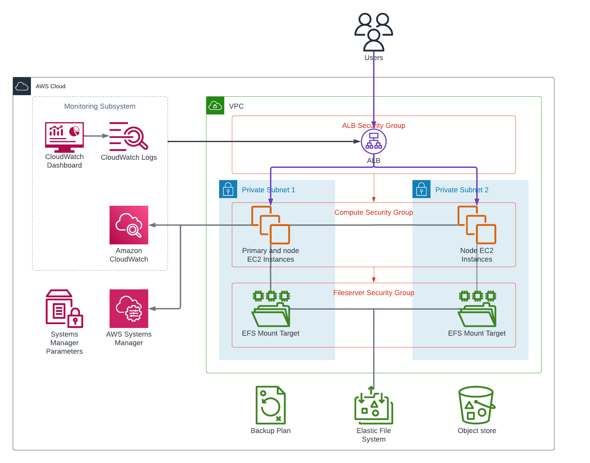

# Infrastructure Terraform Module for ArcGIS Server on Linux

The Terraform module provisions AWS resources for ArcGIS Server deployment on the Linux platform.

  

The module launches one primary SSM-managed EC2 instance and node_count additional instances
in the private VPC subnets or subnets specified by the subnet_ids input variable.
The instances are launched from images retrieved from '/arcgis/${var.enterprise_id}/images/${var.deployment_id}/{instance role}' SSM parameters.
The images must be created by the Packer Template for ArcGIS Server on Linux AMI.

Each instance restores `/dev/sdf` from its own role's AMI snapshot as an
encrypted gp3 volume mounted at `/opt`. Primary and node AMIs are checked
independently; a node image lookup is required only when `node_count` is positive.
Missing data snapshots and `data_disk_size` values smaller than the selected
snapshot fail before instance creation, rather than producing a blank disk.
The image's saved filesystem UUID is retained, and its boot guard expands ext4
when the restored volume is larger. The EFS mount at `/mnt/efs` is unchanged.

For the primary EC2 instance the module creates an "A" record in the VPC Route 53 private hosted zone
to make the instance addressable using a permanent DNS name.

> Note that the EC2 instance will be terminated and recreated if the Terraform module
  is applied again after the SSM parameter value was modified by a new image build.

If fileserver_deployment_id input variable is not specified, a new EFS file system will be created for this deployment.
Otherwise, the module retrieves the file system ID and security group ID of the specified deployment from SSM parameters.
The file server deployment must be of the same platform (Linux) and must use the same VPC subnets.

The module creates target groups that target the EC2 instances and associates
the target groups with the deployment's load balancer listeners.

By default the HTTPS listener on port 443 is forwarded to instance port 6443.
Set the use_webadaptor input variable to true to use port 443.

The deployment's Monitoring Subsystem consists of:

* A CloudWatch log group
* CloudWatch agent on the EC2 instances that sends the system logs to the log group
  as well as metrics for resource utilization on the EC2 instances.
* A CloudWatch dashboard that displays the CloudWatch metrics and logs of the deployment.

The module also creates an AWS Backup plan in the enterprise's backup vault. The current backup
selection includes the primary EC2 instance, the first node instance (if any), the object-store
S3 bucket, and the EFS file system only when this deployment creates it. Additional node instances
and reused EFS file systems are not selected by this plan; ensure they have separate backup
coverage where required.

All the created AWS resources are tagged with ArcGISEnterpriseID and ArcGISDeploymentID tags.

## Requirements

On the machine where Terraform is executed:

* Python compatible with the installed `ansible-core` version, with the [AWS SDK for Python (Boto3)](https://aws.amazon.com/sdk-for-python/) package installed.
* Path to aws/scripts directory must be added to PYTHONPATH.
* Ansible must be installed to run the EFS-mount playbook; the supplied workflow installs the Ansible 9.x distribution (`ansible>=9.0,<10.0`), which includes `ansible-core` 2.16.
* The `arcgis.common` Ansible collection must be installed for the `arcgis.common.efs_mount` playbook.
* AWS credentials must be configured.

## Troubleshooting

Use Session Manager in the AWS Console to open a shell session on the EC2 instances; this is not an SSH connection.

## SSM Parameters

The module reads the following SSM parameters:

| SSM parameter name | Description |
| --- | --- |
| /arcgis/${var.enterprise_id}/${var.fileserver_deployment_id}/fileserver/file-system-id | EFS file system ID (if ${var.fileserver_deployment_id} is not null) |
| /arcgis/${var.enterprise_id}/${var.fileserver_deployment_id}/fileserver/security-group-id | EFS file system security group ID (if ${var.fileserver_deployment_id} is not null) |
| /arcgis/${var.enterprise_id}/${var.ingress_id}/alb/arn | ALB ARN |
| /arcgis/${var.enterprise_id}/${var.ingress_id}/alb/security-group-id | ALB security group ID |
| /arcgis/${var.enterprise_id}/${var.ingress_id}/ingress-fqdn | Fully qualified domain name of the base ArcGIS Enterprise deployment |
| /arcgis/${var.enterprise_id}/${var.portal_deployment_id}/deployment-url | Deployment URL of Portal for ArcGIS (if portal_deployment_id is set) |
| /arcgis/${var.enterprise_id}/backup/vault-name | Name of the AWS Backup vault |
| /arcgis/${var.enterprise_id}/iam/backup-role-arn | ARN of IAM role used by AWS Backup service |
| /arcgis/${var.enterprise_id}/iam/instance-profile-name | IAM instance profile name |
| /arcgis/${var.enterprise_id}/images/${var.deployment_id}/node | Node EC2 instances AMI ID |
| /arcgis/${var.enterprise_id}/images/${var.deployment_id}/primary | Primary EC2 instance AMI ID |
| /arcgis/${var.enterprise_id}/images/${var.deployment_id}/server-web-context | ArcGIS Server web context |
| /arcgis/${var.enterprise_id}/s3/backup | S3 bucket for the backup |
| /arcgis/${var.enterprise_id}/s3/logs | S3 bucket for SSM command output |
| /arcgis/${var.enterprise_id}/s3/region | S3 buckets region code |
| /arcgis/${var.enterprise_id}/s3/repository | S3 bucket for the private repository |
| /arcgis/${var.enterprise_id}/vpc/hosted-zone-id | VPC hosted zone ID |
| /arcgis/${var.enterprise_id}/vpc/id | VPC ID |
| /arcgis/${var.enterprise_id}/vpc/subnets | IDs of VPC subnets |

The module writes the following SSM parameters:

| SSM parameter name | Description |
| --- | --- |
| /arcgis/${var.enterprise_id}/${var.deployment_id}/fileserver/file-system-id | EFS file system ID (if ${var.fileserver_deployment_id} is null) |
| /arcgis/${var.enterprise_id}/${var.deployment_id}/fileserver/security-group-id | EFS file system security group ID (if ${var.fileserver_deployment_id} is null) |
| /arcgis/${var.enterprise_id}/${var.deployment_id}/backup/plan-id | Backup plan ID for the deployment |
| /arcgis/${var.enterprise_id}/${var.deployment_id}/deployment-url | ArcGIS Server URL |
| /arcgis/${var.enterprise_id}/${var.deployment_id}/ingress-fqdn | Fully qualified domain name of the ingress |
| /arcgis/${var.enterprise_id}/${var.deployment_id}/namespace | Namespace of the deployment used to generate unique resource names |
| /arcgis/${var.enterprise_id}/${var.deployment_id}/object-store-s3-bucket | S3 bucket for the object store |
| /arcgis/${var.enterprise_id}/${var.deployment_id}/portal-url | Portal for ArcGIS URL (if portal_deployment_id is set) |
| /arcgis/${var.enterprise_id}/${var.deployment_id}/security-group-id | Deployment security group ID |

## Providers

| Name | Version |
| --- | --- |
| aws | ~> 6.10 |
| random | n/a |

## Modules

| Name | Source | Version |
| --- | --- | --- |
| cw_agent | ../../modules/cw_agent | n/a |
| dashboard | ../../modules/dashboard | n/a |
| efs_fileserver | ../../modules/efs_fileserver | n/a |
| enterprise_core_info | ../../modules/enterprise_core_info | n/a |
| nfs_mount | ../../modules/ansible_playbook | n/a |
| security_group | ../../modules/security_group | n/a |
| server_https_alb_target | ../../modules/alb_target_group | n/a |

## Resources

| Name | Type |
| --- | --- |
| [aws_backup_plan.deployment_backup](https://registry.terraform.io/providers/hashicorp/aws/latest/docs/resources/backup_plan) | resource |
| [aws_backup_selection.infrastructure](https://registry.terraform.io/providers/hashicorp/aws/latest/docs/resources/backup_selection) | resource |
| [aws_instance.nodes](https://registry.terraform.io/providers/hashicorp/aws/latest/docs/resources/instance) | resource |
| [aws_instance.primary](https://registry.terraform.io/providers/hashicorp/aws/latest/docs/resources/instance) | resource |
| [aws_network_interface.nodes](https://registry.terraform.io/providers/hashicorp/aws/latest/docs/resources/network_interface) | resource |
| [aws_network_interface.primary](https://registry.terraform.io/providers/hashicorp/aws/latest/docs/resources/network_interface) | resource |
| [aws_route53_record.primary](https://registry.terraform.io/providers/hashicorp/aws/latest/docs/resources/route53_record) | resource |
| [aws_s3_bucket.object_store](https://registry.terraform.io/providers/hashicorp/aws/latest/docs/resources/s3_bucket) | resource |
| [aws_s3_bucket_ownership_controls.object_store](https://registry.terraform.io/providers/hashicorp/aws/latest/docs/resources/s3_bucket_ownership_controls) | resource |
| [aws_s3_bucket_versioning.object_store](https://registry.terraform.io/providers/hashicorp/aws/latest/docs/resources/s3_bucket_versioning) | resource |
| [aws_ssm_parameter.backup_plan_id](https://registry.terraform.io/providers/hashicorp/aws/latest/docs/resources/ssm_parameter) | resource |
| [aws_ssm_parameter.deployment_url](https://registry.terraform.io/providers/hashicorp/aws/latest/docs/resources/ssm_parameter) | resource |
| [aws_ssm_parameter.ingress_fqdn](https://registry.terraform.io/providers/hashicorp/aws/latest/docs/resources/ssm_parameter) | resource |
| [aws_ssm_parameter.namespace](https://registry.terraform.io/providers/hashicorp/aws/latest/docs/resources/ssm_parameter) | resource |
| [aws_ssm_parameter.object_store_s3_bucket](https://registry.terraform.io/providers/hashicorp/aws/latest/docs/resources/ssm_parameter) | resource |
| [aws_ssm_parameter.portal_url](https://registry.terraform.io/providers/hashicorp/aws/latest/docs/resources/ssm_parameter) | resource |
| [aws_ssm_parameter.security_group_id](https://registry.terraform.io/providers/hashicorp/aws/latest/docs/resources/ssm_parameter) | resource |
| [random_id.unique_name_suffix](https://registry.terraform.io/providers/hashicorp/random/latest/docs/resources/id) | resource |
| [aws_ami.ami](https://registry.terraform.io/providers/hashicorp/aws/latest/docs/data-sources/ami) | data source |
| [aws_ami.application](https://registry.terraform.io/providers/hashicorp/aws/latest/docs/data-sources/ami) | data source |
| [aws_lb.alb](https://registry.terraform.io/providers/hashicorp/aws/latest/docs/data-sources/lb) | data source |
| [aws_ssm_parameter.alb_arn](https://registry.terraform.io/providers/hashicorp/aws/latest/docs/data-sources/ssm_parameter) | data source |
| [aws_ssm_parameter.alb_ingress_fqdn](https://registry.terraform.io/providers/hashicorp/aws/latest/docs/data-sources/ssm_parameter) | data source |
| [aws_ssm_parameter.alb_security_group_id](https://registry.terraform.io/providers/hashicorp/aws/latest/docs/data-sources/ssm_parameter) | data source |
| [aws_ssm_parameter.backup_role_arn](https://registry.terraform.io/providers/hashicorp/aws/latest/docs/data-sources/ssm_parameter) | data source |
| [aws_ssm_parameter.backup_vault_name](https://registry.terraform.io/providers/hashicorp/aws/latest/docs/data-sources/ssm_parameter) | data source |
| [aws_ssm_parameter.node_ami](https://registry.terraform.io/providers/hashicorp/aws/latest/docs/data-sources/ssm_parameter) | data source |
| [aws_ssm_parameter.portal_deployment_url](https://registry.terraform.io/providers/hashicorp/aws/latest/docs/data-sources/ssm_parameter) | data source |
| [aws_ssm_parameter.primary_ami](https://registry.terraform.io/providers/hashicorp/aws/latest/docs/data-sources/ssm_parameter) | data source |
| [aws_ssm_parameter.server_web_context](https://registry.terraform.io/providers/hashicorp/aws/latest/docs/data-sources/ssm_parameter) | data source |

## Inputs

| Name | Description | Type | Default | Required |
| --- | --- | --- | --- | :---: |
| aws_region | AWS region ID | `string` | n/a | yes |
| backup_retention | Number of days to retain backups | `number` | `14` | no |
| backup_schedule | Backup schedule in cron format | `string` | `"cron(0 0 * * ? *)"` | no |
| data_disk_iops | Data gp3 volume IOPS; integer 3000-16000 within capacity limits | `number` | `3000` | no |
| data_disk_size | `/opt` data volume capacity in GiB; at least the AMI snapshot size | `number` | `256` | no |
| data_disk_throughput | Data gp3 throughput in MiB/s; 125-1000 and at most one quarter of IOPS | `number` | `125` | no |
| deployment_id | ArcGIS Server deployment ID | `string` | `"server-linux-ansible"` | no |
| enterprise_id | ArcGIS Enterprise ID | `string` | `"arcgis"` | no |
| fileserver_deployment_id | Use the EFS filesystem from the deployment with the given ID. If not specified, a dedicated EFS filesystem will be created for this deployment. | `string` | `null` | no |
| ingress_id | Ingress ID | `string` | `"enterprise-ingress"` | no |
| instance_type | EC2 instance type | `string` | `"m7i.2xlarge"` | no |
| key_name | EC2 key pair name | `string` | n/a | yes |
| listener_rule_priority | Priority of the ALB listener rule that forwards traffic to this deployment. The priority must be unique among all listener rules associated with the same ALB listener. | `number` | `200` | no |
| node_count | Number of node EC2 instances (excluding the primary EC2 instance) | `number` | `1` | no |
| portal_deployment_id | Portal for ArcGIS deployment ID | `string` | `null` | no |
| os_disk_iops | OS gp3 disk IOPS for primary and nodes | `number` | `3000` | no |
| os_disk_size | OS disk size in GiB; integer 256-16384 | `number` | `256` | no |
| os_disk_throughput | OS gp3 throughput in MiB/s; 125-1000 and at most one quarter of IOPS | `number` | `125` | no |
| subnet_ids | EC2 instance subnet IDs (defaults to the complete private VPC subnet list; the primary uses the first subnet and nodes are distributed starting from the second, wrapping as needed) | `list(string)` | `[]` | no |
| use_webadaptor | If true, port 443 is used as the instance HTTPS port, otherwise 6443 is used. | `bool` | `false` | no |

## Outputs

| Name | Description |
| --- | --- |
| deployment_url | ArcGIS Server URL |
| security_group_id | EC2 security group ID |
