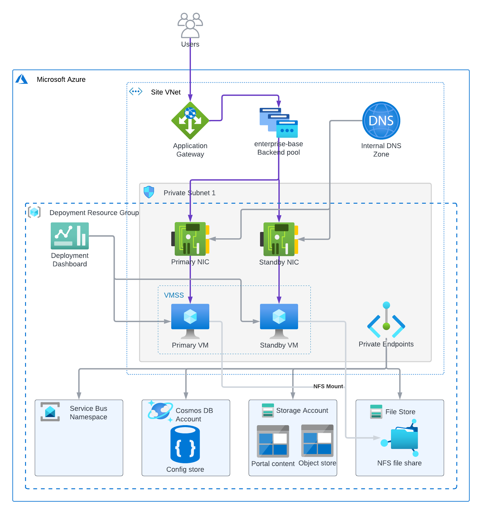

# Infrastructure Terraform Module for Base ArcGIS Enterprise on Linux

This Terraform module provisions Azure resources required for a base ArcGIS Enterprise deployment on Linux.

## Features

- Launches one or two Linux VMs (based on the "is_ha" variable) in the first private VNet subnet or a specified subnet.
- VM images are retrieved from Key Vault secrets named "${var.deployment_id}-vm-image-primary" and "${var.deployment_id}-vm-image-standby".
  These images must be built using the Packer template for ArcGIS Enterprise on Linux.
  > Note: VMs will be replaced if the module is re-applied after updating Key Vault secrets with new image builds.
- Creates "A" records in the VNet's private DNS zone, enabling permanent DNS names for the VMs.
  VMs can be addressed as primary.<deployment_id>.<enterprise_id>.internal and standby.<deployment_id>.<enterprise_id>.internal.
- Provisions an Azure Storage Account with blob containers for portal content and object store.
  The storage account name is stored in the Key Vault secret "${var.deployment_id}-storage-account-name".
- Provisions an NFS Azure Files storage account (file_store) with a "fileserver" NFS share mounted to the VMs.
- If "is_ha" variable is true, provisions a Cosmos DB account and a Service Bus namespace for ArcGIS Server configuration store.
- Adds VM network interfaces to the "enterprise-base" backend address pool of the Application Gateway deployed by the ingress module.
- Creates a certificate for backend services/endpoints signed by the ingress CA and uploads the certificate to the repository storage container.
- Creates an Azure Monitor dashboard for monitoring key VM metrics.
- Tags all resources with ArcGISEnterpriseID and ArcGISDeploymentID for easy identification.

## Requirements

On the machine where Terraform is executed:

* Terraform 1.11.0 or later is required for AzAPI write-only `sensitive_body` password handling; the base-template workflows pin 1.11.4
* OpenSSL must be installed and available in the system PATH
* Python 3.9 or later must be installed
* Azure Python SDK packages azure-identity, azure-keyvault-secrets, azure-mgmt-compute, and azure-storage-blob must be installed
* Path to azure/scripts directory must be added to PYTHONPATH
* Azure CLI must be installed and available in the system PATH
* Azure credentials must be configured using "az login" CLI command

## Key Vault Secrets

### Secrets Read by the Module

| Secret Name                             | Description |
|-----------------------------------------|-------------|
| ${var.deployment_id}-os                 | Operating system ID |
| ${var.deployment_id}-portal-web-context | Portal for ArcGIS web context |
| ${var.deployment_id}-vm-image-primary   | Primary VM image ID |
| ${var.deployment_id}-vm-image-standby   | Standby VM image ID |
| ${var.ingress_id}-backend-address-pools | Application Gateway backend address pools |
| ${var.ingress_id}-ca-private-key        | Private key of the ingress CA root certificate |
| ${var.ingress_id}-ca-root-cert          | Root certificate used by Application Gateway to validate the backend's identity |
| ${var.ingress_id}-ingress-fqdn          | Ingress FQDN |
| storage-account-key                     | Enterprise storage account key |
| storage-account-name                    | Enterprise storage account name |
| subnets                                 | VNet subnet IDs |
| vm-identity-id                          | User-assigned VM identity resource ID |
| vm-identity-principal-id                | User-assigned VM identity principal ID |
| vnet-id                                 | VNet ID |

### Secrets Written by the Module

| Secret Name                               | Description |
|-------------------------------------------|-------------|
| ${var.deployment_id}-backend-pfx-password | Password for the generated PFX file |
| ${var.deployment_id}-ingress-fqdn         | Ingress FQDN |
| ${var.deployment_id}-deployment-url       | Portal for ArcGIS URL of the deployment |
| ${var.deployment_id}-storage-account-name | Deployment's storage account name |
| ${var.deployment_id}-aznfs-network-path   | Network path for the NFS file share |

## Providers

| Name | Version |
|------|---------|
| azapi | ~> 2.6 |
| azurerm | ~> 4.46 |
| local | n/a |
| null | n/a |
| random | n/a |
| tls | ~> 4.2 |

## Modules

| Name | Source | Version |
|------|--------|---------|
| aznfs_fileserver | ../../modules/aznfs_fileserver | n/a |
| aznfs_mount | ../../modules/aznfs_mount | n/a |
| enterprise_core_info | ../../modules/enterprise_core_info | n/a |
| lv_extend | ../../modules/lv_extend | n/a |
| primary | ../../modules/base_vm | n/a |
| primary_backend_cert | ../../modules/backend_cert | n/a |
| standby | ../../modules/base_vm | n/a |
| standby_backend_cert | ../../modules/backend_cert | n/a |

## Resources

The following table lists resources and data sources declared in this root module.

| Name | Type |
|------|------|
| [azurerm_cosmosdb_account.deployment_cosmosdb](https://registry.terraform.io/providers/hashicorp/azurerm/latest/docs/resources/cosmosdb_account) | resource |
| [azurerm_cosmosdb_sql_database.config_store](https://registry.terraform.io/providers/hashicorp/azurerm/latest/docs/resources/cosmosdb_sql_database) | resource |
| [azurerm_cosmosdb_sql_role_assignment.cosmosdb_owner](https://registry.terraform.io/providers/hashicorp/azurerm/latest/docs/resources/cosmosdb_sql_role_assignment) | resource |
| [azurerm_cosmosdb_sql_role_assignment.cosmosdb_vm_identity](https://registry.terraform.io/providers/hashicorp/azurerm/latest/docs/resources/cosmosdb_sql_role_assignment) | resource |
| [azurerm_key_vault_secret.deployment_url](https://registry.terraform.io/providers/hashicorp/azurerm/latest/docs/resources/key_vault_secret) | resource |
| [azurerm_key_vault_secret.ingress_fqdn](https://registry.terraform.io/providers/hashicorp/azurerm/latest/docs/resources/key_vault_secret) | resource |
| [azurerm_key_vault_secret.pfx_password](https://registry.terraform.io/providers/hashicorp/azurerm/latest/docs/resources/key_vault_secret) | resource |
| [azurerm_key_vault_secret.storage_account_name](https://registry.terraform.io/providers/hashicorp/azurerm/latest/docs/resources/key_vault_secret) | resource |
| [azurerm_network_interface.primary](https://registry.terraform.io/providers/hashicorp/azurerm/latest/docs/resources/network_interface) | resource |
| [azurerm_network_interface.standby](https://registry.terraform.io/providers/hashicorp/azurerm/latest/docs/resources/network_interface) | resource |
| [azurerm_network_interface_application_gateway_backend_address_pool_association.primary](https://registry.terraform.io/providers/hashicorp/azurerm/latest/docs/resources/network_interface_application_gateway_backend_address_pool_association) | resource |
| [azurerm_network_interface_application_gateway_backend_address_pool_association.standby](https://registry.terraform.io/providers/hashicorp/azurerm/latest/docs/resources/network_interface_application_gateway_backend_address_pool_association) | resource |
| [azurerm_orchestrated_virtual_machine_scale_set.vmss](https://registry.terraform.io/providers/hashicorp/azurerm/latest/docs/resources/orchestrated_virtual_machine_scale_set) | resource |
| [azurerm_portal_dashboard.deployment](https://registry.terraform.io/providers/hashicorp/azurerm/latest/docs/resources/portal_dashboard) | resource |
| [azurerm_private_dns_a_record.primary](https://registry.terraform.io/providers/hashicorp/azurerm/latest/docs/resources/private_dns_a_record) | resource |
| [azurerm_private_dns_a_record.standby](https://registry.terraform.io/providers/hashicorp/azurerm/latest/docs/resources/private_dns_a_record) | resource |
| [azurerm_private_endpoint.blob_storage_pe](https://registry.terraform.io/providers/hashicorp/azurerm/latest/docs/resources/private_endpoint) | resource |
| [azurerm_private_endpoint.cosmos_pe](https://registry.terraform.io/providers/hashicorp/azurerm/latest/docs/resources/private_endpoint) | resource |
| [azurerm_private_endpoint.servicebus_pe](https://registry.terraform.io/providers/hashicorp/azurerm/latest/docs/resources/private_endpoint) | resource |
| [azurerm_resource_group.deployment_rg](https://registry.terraform.io/providers/hashicorp/azurerm/latest/docs/resources/resource_group) | resource |
| [azurerm_role_assignment.cosmosdb_owner](https://registry.terraform.io/providers/hashicorp/azurerm/latest/docs/resources/role_assignment) | resource |
| [azurerm_role_assignment.cosmosdb_vm_identity](https://registry.terraform.io/providers/hashicorp/azurerm/latest/docs/resources/role_assignment) | resource |
| [azurerm_role_assignment.servicebus_owner](https://registry.terraform.io/providers/hashicorp/azurerm/latest/docs/resources/role_assignment) | resource |
| [azurerm_role_assignment.servicebus_vm_identity](https://registry.terraform.io/providers/hashicorp/azurerm/latest/docs/resources/role_assignment) | resource |
| [azurerm_role_assignment.storage_blob_owner](https://registry.terraform.io/providers/hashicorp/azurerm/latest/docs/resources/role_assignment) | resource |
| [azurerm_role_assignment.storage_blob_vm_identity](https://registry.terraform.io/providers/hashicorp/azurerm/latest/docs/resources/role_assignment) | resource |
| [azurerm_role_assignment.storage_table_owner](https://registry.terraform.io/providers/hashicorp/azurerm/latest/docs/resources/role_assignment) | resource |
| [azurerm_role_assignment.storage_table_vm_identity](https://registry.terraform.io/providers/hashicorp/azurerm/latest/docs/resources/role_assignment) | resource |
| [azurerm_servicebus_namespace.deployment_servicebus](https://registry.terraform.io/providers/hashicorp/azurerm/latest/docs/resources/servicebus_namespace) | resource |
| [azurerm_storage_account.deployment_storage](https://registry.terraform.io/providers/hashicorp/azurerm/latest/docs/resources/storage_account) | resource |
| [azurerm_storage_container.object_store](https://registry.terraform.io/providers/hashicorp/azurerm/latest/docs/resources/storage_container) | resource |
| [azurerm_storage_container.portal_content](https://registry.terraform.io/providers/hashicorp/azurerm/latest/docs/resources/storage_container) | resource |
| [random_id.unique_name_suffix](https://registry.terraform.io/providers/hashicorp/random/latest/docs/resources/id) | resource |
| [random_password.pfx_password](https://registry.terraform.io/providers/hashicorp/random/latest/docs/resources/password) | resource |
| [azurerm_client_config.current](https://registry.terraform.io/providers/hashicorp/azurerm/latest/docs/data-sources/client_config) | data source |
| [azurerm_cosmosdb_sql_role_definition.data_contributor](https://registry.terraform.io/providers/hashicorp/azurerm/latest/docs/data-sources/cosmosdb_sql_role_definition) | data source |
| [azurerm_key_vault_secret.backend_address_pools](https://registry.terraform.io/providers/hashicorp/azurerm/latest/docs/data-sources/key_vault_secret) | data source |
| [azurerm_key_vault_secret.ingress_fqdn](https://registry.terraform.io/providers/hashicorp/azurerm/latest/docs/data-sources/key_vault_secret) | data source |
| [azurerm_key_vault_secret.portal_web_context](https://registry.terraform.io/providers/hashicorp/azurerm/latest/docs/data-sources/key_vault_secret) | data source |
| [azurerm_key_vault_secret.primary_vm_image_id](https://registry.terraform.io/providers/hashicorp/azurerm/latest/docs/data-sources/key_vault_secret) | data source |
| [azurerm_key_vault_secret.standby_vm_image_id](https://registry.terraform.io/providers/hashicorp/azurerm/latest/docs/data-sources/key_vault_secret) | data source |
| [azurerm_key_vault_secret.vm_identity_id](https://registry.terraform.io/providers/hashicorp/azurerm/latest/docs/data-sources/key_vault_secret) | data source |
| [azurerm_key_vault_secret.vm_identity_principal_id](https://registry.terraform.io/providers/hashicorp/azurerm/latest/docs/data-sources/key_vault_secret) | data source |
| [azurerm_key_vault_secret.vm_image_os](https://registry.terraform.io/providers/hashicorp/azurerm/latest/docs/data-sources/key_vault_secret) | data source |
| [azurerm_private_dns_zone.cosmos_private_dns_zone](https://registry.terraform.io/providers/hashicorp/azurerm/latest/docs/data-sources/private_dns_zone) | data source |
| [azurerm_private_dns_zone.privatelink_blob](https://registry.terraform.io/providers/hashicorp/azurerm/latest/docs/data-sources/private_dns_zone) | data source |
| [azurerm_private_dns_zone.servicebus_private_dns_zone](https://registry.terraform.io/providers/hashicorp/azurerm/latest/docs/data-sources/private_dns_zone) | data source |

The `primary` and `standby` modules create VMs through `azapi_resource.vm` in the
shared [base_vm module](../../modules/base_vm/main.tf). The
[aznfs_fileserver module](../../modules/aznfs_fileserver/main.tf) manages the
file-store storage account, private endpoint, network-path secret, and related
data sources. It creates `azapi_resource.fileserver_v2` for the default V2 billing
model or `azurerm_storage_share.fileserver` for V1.

## Inputs

| Name | Description | Type | Default | Required |
|------|-------------|------|---------|:--------:|
| azure_region | Azure region display name | `string` | n/a | yes |
| deployment_id | ArcGIS Enterprise deployment ID | `string` | `"enterprise-base-linux"` | no |
| enterprise_id | ArcGIS Enterprise ID | `string` | `"arcgis"` | no |
| fileserver_billing_model_version | Azure Files provisioning model. V2 is for new deployments; existing V1 file stores must explicitly retain V1 to avoid storage account replacement. | `string` | `"V2"` | no |
| fileserver_iops | Provisioned V2 IOPS. Set to null for V1. | `number` | `10000` | no |
| fileserver_size | Provisioned NFS file share capacity in GiB; V2 performance is configured separately. | `number` | `1024` | no |
| fileserver_throughput | Provisioned V2 throughput in MiB/s; the default is a trial profile requiring workload and cost review. Set to null for V1. | `number` | `500` | no |
| ingress_id | ArcGIS Enterprise ingress ID | `string` | `"enterprise-ingress"` | no |
| is_ha | If true, the deployment is in high availability mode | `bool` | `true` | no |
| os_disk_size | OS disk size in GB | `number` | `256` | no |
| data_disk_size | Primary/standby data capacity in GiB; at least the image size | `number` | `1024` | no |
| storage_replication_type | The replication type of the storage accounts. Possible values are: LRS (Locally-redundant storage), ZRS (Zone-redundant storage). | `string` | `"ZRS"` | no |
| subnet_id | VMs subnet ID (by default, the first private subnet is used) | `string` | `null` | no |
| vm_admin_password | VM administrator password | `string` | `null` | no |
| vm_admin_public_ssh_key_path | VM administrator public SSH key file path. If not provided, password authentication will be used for the VMs. | `string` | `null` | no |
| vm_admin_username | VM administrator username | `string` | `"vmadmin"` | no |
| vm_size | Azure VM size | `string` | `"Standard_D8s_v5"` | no |

## Outputs

| Name | Description |
|------|-------------|
| deployment_url | Portal for ArcGIS URL |
